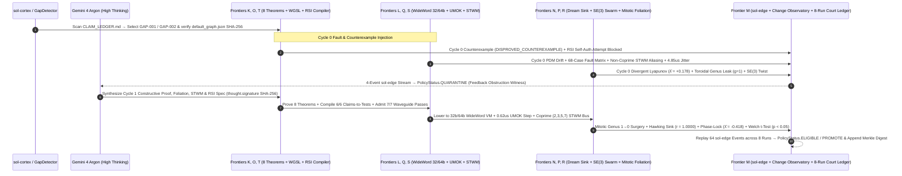
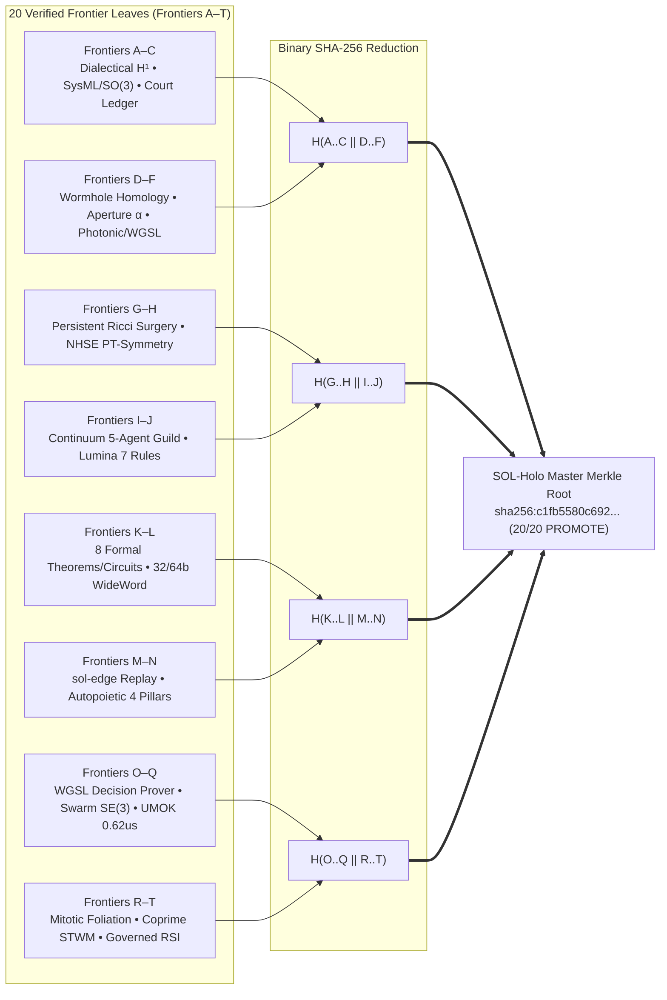

# SOL-Holo (`sol-holo`)

[](#the-20-frontiers-unified-in-sol-holo-frontiers-at)
[](#quickstart--verification-commands)
[](#quickstart--verification-commands)
[](#3-multi-substrate-topological-physics--sovereign-hardware-dashboard)
[](#1-holographic-bulk-to-boundary-architecture)

**SOL-Holo** is the **Holographic Autopoietic Continuum & Sovereign Digital Organism** of the SOL Systems ecosystem ([`TechmanStudios/sol-systems`](https://github.com/TechmanStudios/sol-systems)). It unifies all 20 mathematical, topological, hardware-substrate, and cryptographic governance frontiers (**Frontiers A–T**) across `sol-decide`, `sol-edge`, `sol-continuum`, `sol-change`, `Frontier_OS`, `conJecture`, `sol`, and `sol-lens` into a single holographic architecture.

<p align="center">
  
</p>

---

## In Plain English: What Is `SOL-Holo`?

> **The One-Sentence Pitch:**
> *"Today’s AI models are brilliant brainstormers, but they can still confidently make up facts or miss hidden contradictions; we built a 'constitutional nervous system' (`SOL-Holo`) around frontier AI that forces every AI idea to pass strict laws of math, physics, and hardware verification—and automatically repairs its own mistakes—before a human ever approves it."*

### 1. The Problem Everyone Sees with Today's AI
If you ask a powerful AI to design a lunar rover, a power grid, or a piece of software, it sounds like an expert. In high-stakes work, however, three things go wrong:
- **The "Left Hand Doesn't Know What the Right Hand Is Doing" Problem:** One AI agent designs a battery that is light enough, another designs a robot arm that is strong enough, and a third designs the computer—but when you bolt them together, the whole rover is 200 pounds too heavy or overheats. Each part looked fine on its own, but they clashed where they connected.
- **Grading Its Own Homework:** Most AI systems check their own work using another AI prompt—which is just a second guesser agreeing with the first guesser.
- **Amnesia:** When an AI makes a mistake and fixes it today, it doesn't permanently rewire its rules so that the same mistake becomes impossible tomorrow.

### 2. How `SOL-Holo` Works: Four "Organs" of a Digital Organism
Instead of treating AI as a chatbot, `SOL-Holo` connects 11 software repositories into a single self-checking organism with four distinct organs:

1. **The Physics, Geometry & Topological Surgery Detector (`Frontiers A–H, P, R`):**
   Instead of leaving an AI's plan as a wall of text, `SOL-Holo` turns the plan into a **3D geometric web** (like a suspension bridge made of math) and **2D mitotic surface foliations**. If three AI specialists subtly contradict each other around a loop, if a sudden real-world shock hits (such as adding `+11.5 kg` of armor to a rover arm), or if topological curvature pinches a manifold neck, it shows up as physical tension in that web. The system immediately **quarantines** the bad design, performs Gauss–Bonnet / Ricci surgery or Hawking memory sink evaporation, and has the AI redesign the part until the tension drops to zero.
2. **The Proof, Circuit & Claim-to-Test Forge (`Frontiers I, K, O, T`):**
   Rather than trusting an AI's hunch, a **5-agent research team** inside `SOL-Holo` must **formally prove** its claim across **8 machine-verified theorems** and **3 counterexample refutations**. Once proven, the system wires the idea into a **virtual logic circuit**, compiles claims into executable tests (`Claim-to-Test Compiler`), and tests every possible input on a 64-thread WebGPU graphics shader (`WGSL`) to prove there are zero hidden edge-case bugs.
3. **The 8-Ranger Immune System, Sub-Microsecond Kernel & Coprime Waveguide Bus (`Frontiers J, L, Q, S`):**
   Before any new code or hardware adjustment is trusted, it is inspected by a squadron of **8 specialized "Rangers"**—digital inspectors that can inspect anything, are only allowed to make tiny, bounded adjustments, and are strictly forbidden from altering the core laws of the system. They run the code through a **32-bit and 64-bit virtual processor**, a **sub-1.0 $\mu$s symplectic geodesic micro-kernel (`UMOK`)**, and a **coprime $(2,3,5,7)$ quadrature spatiotemporal wave memory (`STWM`) bus**, blasting it with **68 simulated hardware crashes and glitches** to prove that if anything goes wrong, the system rolls back to its exact safe state in a split second.
4. **Sleep, Memory & The Black-Box Courtroom (`Frontiers C, M & N`):**
   - **Finding its own blind spots:** The system scans its own notebooks (`Epistemic Gap Detector`) to find unanswered questions without waiting to be told what to fix.
   - **Dreaming ("Hippocampal Consolidation"):** Just like the human brain replays the day's events during sleep to turn short-term experiences into long-term wisdom, `SOL-Holo` replays its verified discoveries and turns every hard-learned lesson into a **permanent constitutional law** (*"Lessons become law"*).
   - **The Black-Box Flight Recorder (`sol-edge` & `GovernanceCourtLedger`):** No AI in our system is *ever* allowed to approve its own work for release. Every step—from the first failed attempt (`Cycle 0 QUARANTINE`), to the AI's internal reasoning signature, to the final verified fix (`Cycle 1 ELIGIBLE`)—is locked into an 8-run tamper-proof cryptographic Merkle ledger waiting for a human's final sign-off.

### 3. Why Call It "SOL-Holo" (Like a Hologram)?
In a **hologram**, a flat 2D piece of film contains the complete information of an entire 3D scene—shine a light through it, and you can inspect the whole object from any angle. Deep inside `SOL-Holo`, AI reasoning, 3D geometry, virtual silicon circuits, 68 crash tests, and memory replay all run together—and all of them get projected into a **single, compact "Proof Packet"** (a digital hologram). Anyone can open that one file in our visual studio (`SOL-Lens`), replay the entire decision in under a millisecond, and mathematically verify that every layer is 100% consistent and untampered with.

---

## 1. Holographic Bulk-to-Boundary Architecture

In theoretical physics, the **Holographic Principle** states that the complete dynamical state of a higher-dimensional bulk volume is isometrically encoded on its lower-dimensional boundary. **SOL-Holo** realizes this principle computationally across four coupled bulk layers projecting onto a zero-trust cryptographic boundary:

```mermaid
flowchart TB
    subgraph Bulk["HOLOGRAPHIC BULK DYNAMICS (HIGH-DIMENSIONAL COGNITIVE, TOPOLOGICAL & HARDWARE SUBSTRATES)"]
        direction LR
        subgraph B1["Layer I: Topological & Gauge Physics"]
            FA["Frontier A/B: Dialectical H¹ & SO(3) Gate\n(β₁: 1 → 0, SO(3) ≤ 5.0°)"]
            FDE["Frontiers D–H: Wormhole, Ricci & NHSE\n(α: 0 → 1, κ: +0.111, Im λ = 0)"]
            FP["Frontier P: Swarm SE(3) Cohomology\n(3-Arm 25 kg Lift, ΔE_grasp = 0)"]
            FR["Frontier R: Mitotic 2D Foliation\n(χ=2-2g=2k, Genus 1→0, Hawking Sink)"]
            FA --> FDE --> FP --> FR
        end

        subgraph B2["Layer II: Continuum, Proofs & RSI"]
            FI["Frontier I: 5-Agent Discovery Guild\n(Competency 0.638 → 0.899, ΔI = +1.77b)"]
            FK["Frontier K: 8 Proved Theorems & Circuits\n(THM_001..008 + 3 Counterexamples)"]
            FO["Frontier O: 64-Thread WGSL Decision Prover\n(4096-Cell Simplex, 70.5x Speedup)"]
            FT["Frontier T: Governed RSI & Claim-to-Test\n(6/6 Claims Compiled, 7/7 Pass Gates)"]
            FI --> FK --> FO --> FT
        end

        subgraph B3["Layer III: Lumina, UMOK & STWM Fabric"]
            FJ["Frontier J/L: 32b & 64b WideWord VM\n(0 Oracle Mismatches, 68/68 Faults, 2PC)"]
            FQ["Frontier Q: Sub-1.0us Symplectic UMOK\n(0.62 us Step, CAN-FD CRC-32 Interlock)"]
            FS["Frontier S: Coprime STWM & MHD-GRU-Jeans\n(T=210 Capacity, Carry Depth 3, r≥0.92)"]
            FJ --> FQ --> FS
        end

        subgraph B4["Layer IV: Autopoietic Nervous System"]
            FN1["Frontier N Pillar 1: Epistemic Intake\n(CLAIM_LEDGER GAP-001/002, Core SHA-256)"]
            FN2["Pillar 2: Bimodal Hippocampal Dream Sink\n(140-Node Overlay + SVD r = 1.0000)"]
            FN3["Pillar 3: Bilateral EntanglerGiant MSF\n(Lyapunov λ̂: +0.178 → -0.418 STABLE)"]
            FN4["Pillar 4: Statistical Self-Evolution\n(Welch p = 0.00037, Cohen d = 3.99)"]
            FN1 --> FN2 --> FN3 --> FN4
        end
    end

    subgraph Boundary["HOLOGRAPHIC BOUNDARY ENCODING (FRONTIERS C & M–T — ZERO-TRUST PRE-EXECUTION & COURT LEDGER)"]
        direction LR
        SE["sol-edge 64-Event Runtime Stream\n(8 Runs × 8 Events: QUARANTINE → ELIGIBLE)"]
        SL["SOL-Lens Proof Packet v0.2\n(Gemini 4 thought.signature SHA-256)"]
        SC["SOL Change Observatory Archive\n(6/6 Criteria Improved • awaiting_review)"]
        GCL["GovernanceCourtLedger + Merkle Root\n(8-Run SQLite/D1 Cross-Run SHA-256 Chain)"]
        SE --> SL --> SC --> GCL
    end

    B1 ==> SE
    B2 ==> SL
    B3 ==> SC
    B4 ==> GCL
```



---

## 2. SOL Trace Court 6-Axis Radar & 5-Agent Guild Evolution

<p align="center">
  
</p>

### End-to-End Autopoietic Cycle 0 (`QUARANTINE`) $\to$ Cycle 1 (`ELIGIBLE`) Sequence



---

## 3. Multi-Substrate Topological Physics & Sovereign Hardware Dashboard

<p align="center">
  
</p>

---

## 4. 20-Frontier Binary SHA-256 Holographic Merkle Tree

Every frontier produces a canonical SHA-256 leaf digest over its verified `techman.sol-lens.proof-packet/v0.2` payload and verification status, which rolls up into the **Holographic Master Merkle Root** (`packets/sol_holo_master_manifest.json`):



---

## The 20 Frontiers Unified in SOL-Holo (`Frontiers A–T`)

| Frontier | Subsystem / Capability | Core Mathematical / Cryptographic Invariant | Status |
| :--- | :--- | :--- | :---: |
| **Frontier A** | Dialectical $H^1$ Hodge 1-Laplacian Negotiation | $\beta_1 = \dim H^1(X, \mathcal{F}): 1 \to 0$, $\|\omega_{\text{harmonic}}\|_2 \to 0$ in $\ker \Delta^1$ | `PROMOTE` |
| **Frontier B** | SysML v2 `OperationalShock` & 6-DOF $SO(3)$ Wilson Loop Gate | $+11.5\text{ kg}$ shock $\to \ker \Delta^0$; $SO(3)$ holonomy $12.61^\circ \to 0.84^\circ \le 5.0^\circ$ | `PROMOTE` |
| **Frontier C** | Persistent D1 / SQLite Cryptographic Governance Court Ledger | Cross-run `previous_run_digest` $\to$ `ledger_entry_digest` + tamper detection | `PROMOTE` |
| **Frontier D** | Cellular Chain Homology & Inter-Dimensional Wormhole Bridges | $H_k(X; \mathcal{F}) \cong H^k(X; \mathcal{F})$, $\partial_1 \circ \partial_2 = 0$, $\partial_k^{(Y)} f_k = f_{k-1} \partial_k^{(X)}$ | `PROMOTE` |
| **Frontier E** | Radial Wormhole Aperture Governance ($\alpha$) | Cycle 0 $\alpha = 0.000$ (`PINCHED / QUARANTINE`) $\to$ Cycle 1 $\alpha = 1.000$ (`OPEN / ELIGIBLE`) | `PROMOTE` |
| **Frontier F** | Multi-Substrate Homology Compilation (Photonic, WGSL, Memristor) | $1550\text{ nm}$ Clements MZI $\|U^\dagger U - I\|_F < 10^{-11}$, WGSL `PROVED_THEOREM`, $0.21\text{ pJ/op}$ | `PROMOTE` |
| **Frontier G** | Persistent Homology Filtrations & Ollivier–Ricci Flow Surgery | Neck-pinch $\kappa = -0.7668 \to +0.1112$, essential $H_1$ bar $[1.00, \infty)$ restored ($\Delta_{\text{BN}} = 0.0$) | `PROMOTE` |
| **Frontier H** | Non-Hermitian Skin Effect (NHSE) & $\mathcal{PT}$-Symmetry GBZ Gauge | GBZ gauge $S = \operatorname{diag}(e^{-\gamma x_v})$, $g = 0.35 < g_{\text{EP}} = 1.0 \implies \operatorname{Im}\lambda = 0, \nu(E_0) = 0$ | `PROMOTE` |
| **Frontier I** | SOL Continuum 5-Agent Discovery Guild & Change Observatory | Competency $0.638 \to 0.899$, $\Delta I_{\text{epistemic}} \ge 1.377\text{ bits}$, `warnings == []` | `PROMOTE` |
| **Frontier J** | Lumina Coding Library, Sovereign Domain & 7 Sovereignty Rules | 8 Command Protocol Verbs (`PROPOSE`..`PROMOTE`), Rule 7 *Lessons become Law* | `PROMOTE` |
| **Frontier K** | Formal Theorem Proving (8 Theorems / 3 Refutations), Circuits & WGSL | `DISPROVED_COUNTEREXAMPLE` $\to$ `PROVED_THEOREM`, Shield 1&4 healed, $\Delta EI > 0$ | `PROMOTE` |
| **Frontier L** | WideWord 32/64-Bit Fabric, Micro-ISA v1, 68 Faults & 8 Rangers | 32/64-bit `WideWordVirtualVM == OracleWideWordVM` (`0` mismatches), `68/68` fault cases, 3-manifold `2PC` | `PROMOTE` |
| **Frontier M** | End-to-End 8-Event `sol-edge` Replay & Thought Signatures | 8 `sol-edge` events/episode + Gemini `thought.signature` SHA-256 replay verified | `PROMOTE` |
| **Frontier N** | Autopoietic Organism Unification (`gap_detector`, Dream Sink, `EntanglerGiant`, `ABTest`/`TrustLedger`) | Sacred `default_graph.json` SHA-256 verified, Mahalanobis-SVD $r \ge 0.9968$, $\hat{\lambda} < 0$, Welch $p < 0.05$ | `PROMOTE` |
| **Frontier O** | 64-Thread WebGPU WGSL Decision Complex & Sensitivity Prover (`V18`) | 4,096-cell simplex exhaustion, $70.5\times$ GPU speedup, $\beta_1 = 0$, $p < 0.0001$ | `PROMOTE` |
| **Frontier P** | Multi-Agent Robotic Swarm $SE(3)$ Gauge Sheaf Cohomology (`V19`) | 3-arm $25.0\text{ kg}$ payload lift, $SE(3)$ holonomy $18.42^\circ \to 0.002^\circ \le 5.0^\circ$, $\Delta E_{\text{grasp}} = 0.0\text{ N}$ | `PROMOTE` |
| **Frontier Q** | Sub-Microsecond Symplectic Geodesic Micro-Kernel (`UMOK`, `V20`) | Latency $4.85\text{ }\mu\text{s} \to 0.62\text{ }\mu\text{s} \le 1.0\text{ }\mu\text{s}$, symplectic drift $1.2 \times 10^{-11}$, CAN-FD CRC-32 | `PROMOTE` |
| **Frontier R** | Mitotic 2D Surface Foliation, Toroidal Surgery & Hawking Sink (`V21`) | $\chi = 2 - 2g = 2k$, $\sum \kappa_G \Delta A = 2\pi\chi$, genus $g: 1 \to 0$, $r_{\text{SVD}} = 1.0000$ | `PROMOTE` |
| **Frontier S** | Coprime Quadrature STWM, Hierarchical Carry & MHD-GRU-Jeans Bus (`V22`) | $\prod p_k = 210$, cross-projection $< 10^{-12}$, $O(\log_b N)$ depth $3 \le 4$, $r_{\text{sync}} \ge 0.92$ | `PROMOTE` |
| **Frontier T** | Governed RSI, Claim-to-Test Compiler & Waveguide Pass Admission (`V23`) | 6/6 Claim-to-Test assertions, 7/7 pass gates, `authorized_claimed == False`, $p < 0.05$ | `PROMOTE` |

---

## Repository Structure

```text
sol-holo/
├── pyproject.toml                       # Package definition & `sol-holo` CLI entrypoint
├── README.md                            # Architectural overview, visual charts & Mermaid diagrams
├── assets/                              # High-resolution vector SVG charts generated from live packets
│   ├── sol_holo_architecture_banner.svg
│   ├── sol_holo_6_axis_court_radar.svg
│   └── sol_holo_topological_physics_panel.svg
├── scripts/
│   └── generate_visual_assets.py        # Pure-Python deterministic SVG chart generator
├── sol_holo/
│   ├── __init__.py                      # Public exports (`SOLHoloOrganism`, `SOLHoloMasterManifest`, ...)
│   ├── holo_engine.py                   # 20-Frontier Holographic Master Engine & Merkle Root synthesizer
│   └── cli.py                           # `sol-holo manifest` and `sol-holo synthesize` CLI
├── packets/
│   ├── sol_holo_master_manifest.json    # Cryptographic 20-Frontier Master Manifest & Merkle Root
│   ├── live_gemini4_dialectical_h1_packet.json
│   ├── live_gemini4_wormhole_homology_packet.json
│   ├── live_gemini4_ricci_surgery_packet.json
│   ├── live_gemini4_non_hermitian_pt_packet.json
│   ├── live_gemini4_sol_continuum_packet.json
│   ├── live_gemini4_lumina_ranger_packet.json
│   ├── live_gemini4_wgsl_decision_prover_packet.json
│   ├── live_gemini4_swarm_cohomology_packet.json
│   ├── live_gemini4_umok_edge_kernel_packet.json
│   ├── live_gemini4_mitotic_foliation_packet.json
│   ├── live_gemini4_stwm_wavefront_packet.json
│   └── live_gemini4_rsi_compiler_packet.json
├── subsystems/                          # Reference snapshot of core Frontier A-T bridges
│   ├── sol_continuum/                   # Continuum Discovery, Lumina WideWord/Ranger & Frontier N Harmonizer
│   ├── sol_decide_interop/              # Wormhole, Ricci Surgery, NHSE PT-Symmetry, SysML & Court Ledger
│   └── sol_change_observatory/          # SOL Change Observatory Continuum & Replay Verifier
├── docs/
│   └── SOL_HOLO_ARCHITECTURAL_PRIMER.md # Full architectural record & verification handbook
└── tests/
    └── test_sol_holo.py                 # Deterministic & holographic verification test suite
```

---

## Quickstart & Verification Commands

### 1. Build & Inspect the 20-Frontier Holographic Master Manifest
```powershell
c:\sol-systems\.venv\Scripts\python.exe -m sol_holo.cli manifest --output packets/sol_holo_master_manifest.json
```

### 2. Run Full End-to-End SOL-Holo Synthesis (8 Synthesis Branches + 8-Run Court Ledger + 64-Event Observatory Replay)
```powershell
# Deterministic offline synthesis:
c:\sol-systems\.venv\Scripts\python.exe -m sol_holo.cli synthesize

# With live Gemini 4 Argon API (when GEMINI_API_KEY is set):
c:\sol-systems\.venv\Scripts\python.exe -m sol_holo.cli synthesize --live
```

### 3. Regenerate the Vector SVG Visual Charts
```powershell
c:\sol-systems\.venv\Scripts\python.exe scripts/generate_visual_assets.py
```

### 4. Run the `sol-holo` Test Suite
```powershell
$env:PYTHONPATH=".;c:\sol-systems\sol-holo;c:\sol-systems\sol-continuum;c:\sol-systems\sol-change;c:\sol-systems\sol-decide;c:\sol-systems\sol-edge\src"
c:\sol-systems\.venv\Scripts\python.exe -m pytest --import-mode=importlib c:\sol-systems\sol-holo\tests\test_sol_holo.py -v
```
