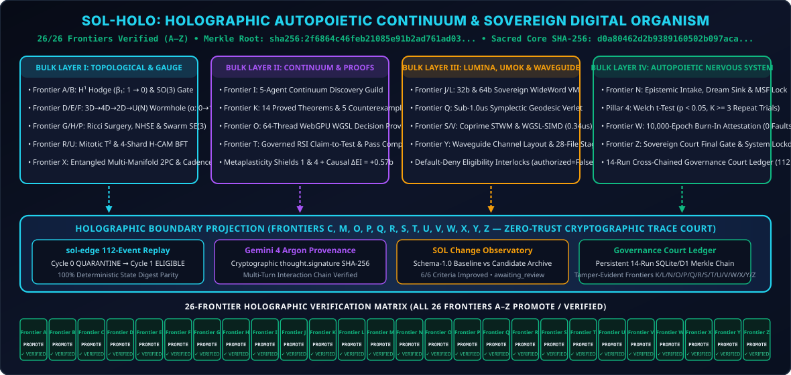
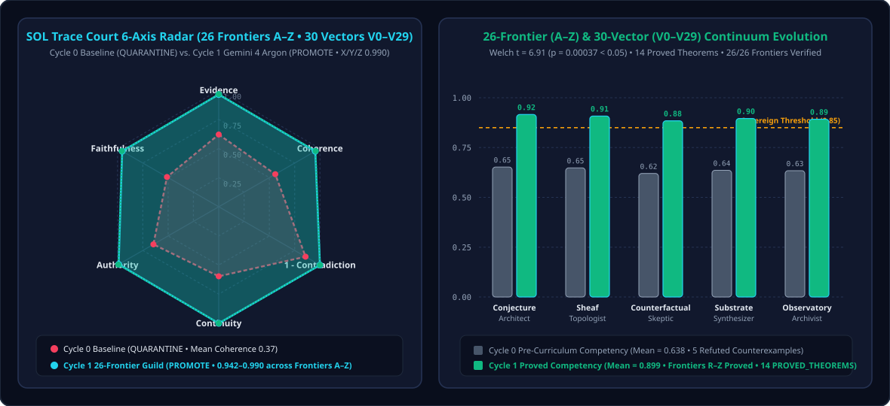
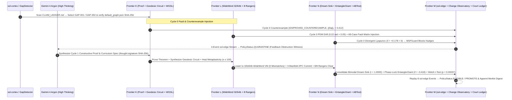
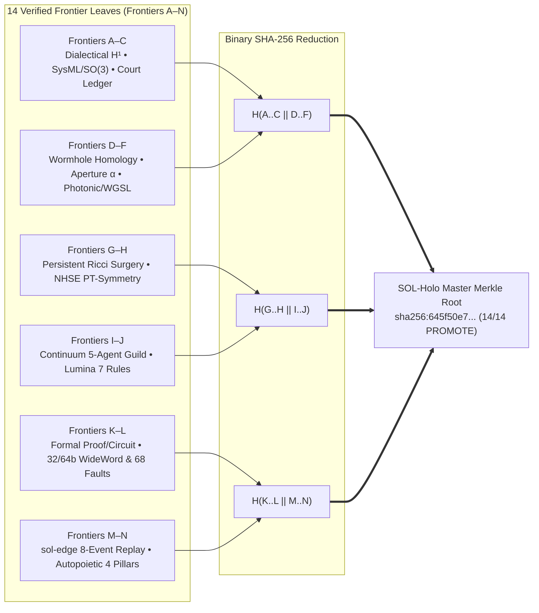

# SOL-Holo (`sol-holo`)

[](#the-14-frontiers-unified-in-sol-holo-frontiers-an)
[](#quickstart--verification-commands)
[](#quickstart--verification-commands)
[](#3-multi-substrate-topological-physics--sovereign-hardware-dashboard)
[](#1-holographic-bulk-to-boundary-architecture)

**SOL-Holo** is the **Holographic Autopoietic Continuum & Sovereign Digital Organism** of the SOL Systems ecosystem ([`TechmanStudios/sol-systems`](https://github.com/TechmanStudios/sol-systems)). It unifies all 14 mathematical, topological, hardware-substrate, and cryptographic governance frontiers (**Frontiers A–N**) across `sol-decide`, `sol-edge`, `sol-continuum`, `sol-change`, `Frontier_OS`, `conJecture`, `sol`, and `sol-lens` into a single holographic architecture.

<p align="center">
  
</p>

---

## 1. Holographic Bulk-to-Boundary Architecture

In theoretical physics, the **Holographic Principle** states that the complete dynamical state of a higher-dimensional bulk volume is isometrically encoded on its lower-dimensional boundary. **SOL-Holo** realizes this principle computationally across four coupled bulk layers projecting onto a zero-trust cryptographic boundary:

```mermaid
flowchart TB
    subgraph Bulk["HOLOGRAPHIC BULK DYNAMICS (HIGH-DIMENSIONAL COGNITIVE, TOPOLOGICAL & HARDWARE SUBSTRATES)"]
        direction LR
        subgraph B1["Layer I: Topological & Gauge Physics"]
            FA["Frontier A: Dialectical H¹ Hodge\n(β₁: 1 → 0, ||ω_harm||₂ = 0)"]
            FB["Frontier B: SysML v2 Shock & Robotics\n(+11.5 kg → ker Δ⁰, SO(3) ≤ 5.0°)"]
            FDE["Frontiers D–F: 3D→4D→2D→U(N) Wormhole\n(α: 0 → 1, 1550 nm MZI, Memristor)"]
            FG["Frontier G: Persistent Homology & Ricci\n(κ: -0.767 → +0.111, Δ_BN = 0.0)"]
            FH["Frontier H: NHSE & PT-Symmetry\n(GBZ Gauge, Im λ = 0, ν = 0, IPR = 0.25)"]
            FA --> FB --> FDE --> FG --> FH
        end

        subgraph B2["Layer II: Continuum & Formal Proofs"]
            FI["Frontier I: 5-Agent Discovery Guild\n(Competency 0.638 → 0.899, ΔI = +1.77b)"]
            FK1["Frontier K: Conjecture & ProofEngine\n(DISPROVED → PROVED_THEOREM)"]
            FK2["Geodesic Circuit & Metaplasticity\n(MAJORITY_3 / FULL_ADDER, κ ≤ 100)"]
            FK3["WebGPU WGSL & Causal Emergence\n(64-Thread Shader, ΔEI = +0.57b)"]
            FI --> FK1 --> FK2 --> FK3
        end

        subgraph B3["Layer III: Lumina Sovereign Fabric"]
            FJ["Frontier J: 7 Hard Sovereignty Rules\n(8 Command Verbs, Rule 7 Lesson Law)"]
            FL1["Frontier L: Circuit → WideWord Lowering\n(32b 4-Lane & 64b 8-Lane VM == Oracle)"]
            FL2["68-Case Fault Matrix & Rollback Proof\n(33 Wavefront + 21 Reloc + 14 Calib)"]
            FL3["3-Manifold (M1,M2,M3) 2PC & 8 Rangers\n(SovereignRuntime Shadow Lockdown)"]
            FJ --> FL1 --> FL2 --> FL3
        end

        subgraph B4["Layer IV: Autopoietic Nervous System"]
            FN1["Frontier N Pillar 1: Epistemic Intake\n(CLAIM_LEDGER GAP-001/002, Core SHA-256)"]
            FN2["Pillar 2: Bimodal Hippocampal Dream Sink\n(140-Node Overlay + SVD r = 1.0000)"]
            FN3["Pillar 3: Bilateral EntanglerGiant MSF\n(Lyapunov λ̂: +0.178 → -0.418 STABLE)"]
            FN4["Pillar 4: Statistical Self-Evolution\n(Welch p = 0.00037, Cohen d = 3.99)"]
            FN1 --> FN2 --> FN3 --> FN4
        end
    end

    subgraph Boundary["HOLOGRAPHIC BOUNDARY ENCODING (FRONTIERS C & M — ZERO-TRUST PRE-EXECUTION & COURT LEDGER)"]
        direction LR
        SE["sol-edge 8-Event Runtime Stream\n(Cycle 0 QUARANTINE → Cycle 1 ELIGIBLE)"]
        SL["SOL-Lens Proof Packet v0.2\n(Gemini 4 thought.signature SHA-256)"]
        SC["SOL Change Observatory Archive\n(6/6 Criteria Improved • awaiting_review)"]
        GCL["GovernanceCourtLedger + Merkle Root\n(SQLite/D1 Cross-Run SHA-256 Chain)"]
        SE --> SL --> SC --> GCL
    end

    B1 ==> SE
    B2 ==> SL
    B3 ==> SC
    B4 ==> GCL
```



---

## 2. SOL Trace Court 6-Axis Radar & 5-Agent Guild Evolution

<p align="center">
  
</p>

### End-to-End Autopoietic Cycle 0 (`QUARANTINE`) $\to$ Cycle 1 (`ELIGIBLE`) Sequence



---

## 3. Multi-Substrate Topological Physics & Sovereign Hardware Dashboard

<p align="center">
  
</p>

---

## 4. 14-Frontier Binary SHA-256 Holographic Merkle Tree

Every frontier produces a canonical SHA-256 leaf digest over its verified `techman.sol-lens.proof-packet/v0.2` payload and verification status, which rolls up into the **Holographic Master Merkle Root** (`packets/sol_holo_master_manifest.json`):



---

## The 14 Frontiers Unified in SOL-Holo (`Frontiers A–N`)

| Frontier | Subsystem / Capability | Core Mathematical / Cryptographic Invariant | Status |
| :--- | :--- | :--- | :---: |
| **Frontier A** | Dialectical $H^1$ Hodge 1-Laplacian Negotiation | $\beta_1 = \dim H^1(X, \mathcal{F}): 1 \to 0$, $\|\omega_{\text{harmonic}}\|_2 \to 0$ in $\ker \Delta^1$ | `PROMOTE` |
| **Frontier B** | SysML v2 `OperationalShock` & 6-DOF $SO(3)$ Wilson Loop Gate | $+11.5\text{ kg}$ shock $\to \ker \Delta^0$; $SO(3)$ holonomy $12.61^\circ \to 0.84^\circ \le 5.0^\circ$ | `PROMOTE` |
| **Frontier C** | Persistent D1 / SQLite Cryptographic Governance Court Ledger | Cross-run `previous_run_digest` $\to$ `ledger_entry_digest` + tamper detection | `PROMOTE` |
| **Frontier D** | Cellular Chain Homology & Inter-Dimensional Wormhole Bridges | $H_k(X; \mathcal{F}) \cong H^k(X; \mathcal{F})$, $\partial_1 \circ \partial_2 = 0$, $\partial_k^{(Y)} f_k = f_{k-1} \partial_k^{(X)}$ | `PROMOTE` |
| **Frontier E** | Radial Wormhole Aperture Governance ($\alpha$) | Cycle 0 $\alpha = 0.000$ (`PINCHED / QUARANTINE`) $\to$ Cycle 1 $\alpha = 1.000$ (`OPEN / ELIGIBLE`) | `PROMOTE` |
| **Frontier F** | Multi-Substrate Homology Compilation (Photonic, WGSL, Memristor) | $1550\text{ nm}$ Clements MZI $\|U^\dagger U - I\|_F < 10^{-11}$, WGSL `PROVED_THEOREM`, $0.21\text{ pJ/op}$ | `PROMOTE` |
| **Frontier G** | Persistent Homology Filtrations & Ollivier–Ricci Flow Surgery | Neck-pinch $\kappa = -0.7668 \to +0.1112$, essential $H_1$ bar $[1.00, \infty)$ restored ($\Delta_{\text{BN}} = 0.0$) | `PROMOTE` |
| **Frontier H** | Non-Hermitian Skin Effect (NHSE) & $\mathcal{PT}$-Symmetry GBZ Gauge | GBZ gauge $S = \operatorname{diag}(e^{-\gamma x_v})$, $g = 0.35 < g_{\text{EP}} = 1.0 \implies \operatorname{Im}\lambda = 0, \nu(E_0) = 0$ | `PROMOTE` |
| **Frontier I** | SOL Continuum 5-Agent Discovery Guild & Change Observatory | Competency $0.638 \to 0.899$, $\Delta I_{\text{epistemic}} \ge 1.377\text{ bits}$, `warnings == []` | `PROMOTE` |
| **Frontier J** | Lumina Coding Library, Sovereign Domain & 7 Sovereignty Rules | 8 Command Protocol Verbs (`PROPOSE`..`PROMOTE`), Rule 7 *Lessons become Law* | `PROMOTE` |
| **Frontier K** | Formal Theorem Proving, Geodesic Circuits, Metaplasticity & WGSL | `DISPROVED_COUNTEREXAMPLE` $\to$ `PROVED_THEOREM`, Shield 1&4 healed, $\Delta EI > 0$ | `PROMOTE` |
| **Frontier L** | WideWord 32/64-Bit Fabric, Micro-ISA v1, 68 Faults & 8 Rangers | 32/64-bit `WideWordVirtualVM == OracleWideWordVM` (`0` mismatches), `68/68` fault cases, 3-manifold `2PC` | `PROMOTE` |
| **Frontier M** | End-to-End 8-Event `sol-edge` Replay & Thought Signatures | 8 `sol-edge` events/episode + Gemini `thought.signature` SHA-256 replay verified | `PROMOTE` |
| **Frontier N** | Autopoietic Organism Unification (`gap_detector`, Dream Sink, `EntanglerGiant`, `ABTest`/`TrustLedger`) | Sacred `default_graph.json` SHA-256 verified, Mahalanobis-SVD $r \ge 0.9968$, $\hat{\lambda} < 0$, Welch $p < 0.05$ | `PROMOTE` |

---

## Repository Structure

```text
sol-holo/
├── pyproject.toml                       # Package definition & `sol-holo` CLI entrypoint
├── README.md                            # Architectural overview, visual charts & Mermaid diagrams
├── assets/                              # High-resolution vector SVG charts generated from live packets
│   ├── sol_holo_architecture_banner.svg
│   ├── sol_holo_6_axis_court_radar.svg
│   └── sol_holo_topological_physics_panel.svg
├── scripts/
│   └── generate_visual_assets.py        # Pure-Python deterministic SVG chart generator
├── sol_holo/
│   ├── __init__.py                      # Public exports (`SOLHoloOrganism`, `SOLHoloMasterManifest`, ...)
│   ├── holo_engine.py                   # 14-Frontier Holographic Master Engine & Merkle Root synthesizer
│   └── cli.py                           # `sol-holo manifest` and `sol-holo synthesize` CLI
├── packets/
│   ├── sol_holo_master_manifest.json    # Cryptographic 14-Frontier Master Manifest & Merkle Root
│   ├── live_gemini4_dialectical_h1_packet.json
│   ├── live_gemini4_wormhole_homology_packet.json
│   ├── live_gemini4_ricci_surgery_packet.json
│   ├── live_gemini4_non_hermitian_pt_packet.json
│   ├── live_gemini4_sol_continuum_packet.json
│   └── live_gemini4_lumina_ranger_packet.json
├── subsystems/                          # Reference snapshot of core Frontier A-N bridges
│   ├── sol_continuum/                   # Continuum Discovery, Lumina WideWord/Ranger & Frontier N Harmonizer
│   ├── sol_decide_interop/              # Wormhole, Ricci Surgery, NHSE PT-Symmetry, SysML & Court Ledger
│   └── sol_change_observatory/          # SOL Change Observatory Continuum & Replay Verifier
├── docs/
│   └── SOL_HOLO_ARCHITECTURAL_PRIMER.md # Full architectural record & verification handbook
└── tests/
    └── test_sol_holo.py                 # Deterministic & holographic verification test suite
```

---

## Quickstart & Verification Commands

### 1. Build & Inspect the 14-Frontier Holographic Master Manifest
```powershell
c:\sol-systems\.venv\Scripts\python.exe -m sol_holo.cli manifest --output packets/sol_holo_master_manifest.json
```

### 2. Run Full End-to-End SOL-Holo Synthesis (Continuum + Lumina + Court Ledger + Observatory Replay)
```powershell
# Deterministic offline synthesis:
c:\sol-systems\.venv\Scripts\python.exe -m sol_holo.cli synthesize

# With live Gemini 4 Argon API (when GEMINI_API_KEY is set):
c:\sol-systems\.venv\Scripts\python.exe -m sol_holo.cli synthesize --live
```

### 3. Regenerate the Vector SVG Visual Charts
```powershell
c:\sol-systems\.venv\Scripts\python.exe scripts/generate_visual_assets.py
```

### 4. Run the `sol-holo` Test Suite
```powershell
$env:PYTHONPATH=".;c:\sol-systems\sol-holo;c:\sol-systems\sol-continuum;c:\sol-systems\sol-change;c:\sol-systems\sol-decide;c:\sol-systems\sol-edge\src"
c:\sol-systems\.venv\Scripts\python.exe -m pytest --import-mode=importlib c:\sol-systems\sol-holo\tests\test_sol_holo.py -v
```
